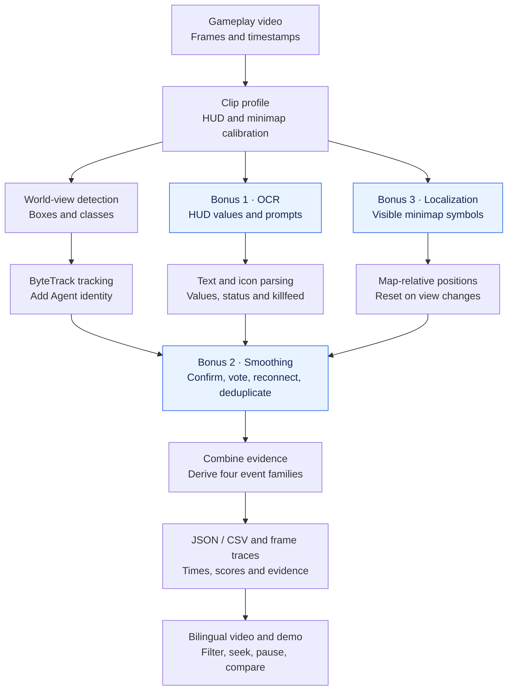

# Gameplay Event Detection from Video — VALORANT

**[Open the interactive demo](https://xuyw041006-arch.github.io/valorant-detect/) · [中文演示](https://xuyw041006-arch.github.io/valorant-detect/DEMO.html) · [Video evaluation](https://xuyw041006-arch.github.io/valorant-detect/EVALUATION_en.html)**

[English](README_en.md) | [简体中文](README_zh.md)

A Python prototype that converts gameplay video pixels into tracked objects and structured events. It detects enemy/teammate bodies, dropped/planted Spike and ground weapons, and adds HUD, killfeed and selected ability observations. No game-memory access or live match telemetry is used.

The submission includes [Python source](src/valorant_events/), this bilingual README, [sample JSON](events.json)/[CSV](events.csv), and [English](docs/presentation/valorant_demo_en.mp4)/[Chinese](docs/presentation/valorant_demo_zh.mp4) annotated videos. The interactive [demo](docs/DEMO_en.html) provides four event families and 21 filters for its 128 reviewed events. View the hosted demo directly, or use the local server below.

## Approach used

Each frame supplies three observation paths: the world view, gameplay UI and minimap. Temporal rules stabilize those observations before evidence is combined into events. The diagram identifies where the first three assignment bonuses are used. It shows data flow; modules run at the sampling intervals enabled by each video profile, rather than every model running on every frame.



**Bonus 1 — Read gameplay UI information as well as world objects.** Normalized regions crop health, ammo, the killfeed and prompts. Profile-specific resizing or thresholding prepares the crops for EasyOCR. Numeric readings must pass confidence, complete-digit-string and range checks; failed readings remain unknown rather than becoming zero. After repeated confirmation, health/ammo changes produce `state_changed` records with `field`, `from` and `to`. Text such as `SPIKE DOWN` and `SPIKE CARRIER KILLED` supplies Spike-state evidence. Killfeed interpretation also uses portrait and weapon-icon matching to add victim, killer and weapon fields when supported. See [HUD OCR](src/valorant_events/hud.py), [tactical UI processing](src/valorant_events/tactical.py) and [killfeed weapon matching](src/valorant_events/killfeed_weapon.py).

**Bonus 2 — Stabilize observations across time.** ByteTrack associates boxes; the event layer then applies confidence-weighted label voting, multi-frame confirmation, disappearance waiting and prompt deduplication. For example, the [P006 profile](configs/integrated_p006.json) requires at least three supporting observations spanning 0.25 seconds and 70% of weighted votes within a 1.5-second window. An enemy track must remain absent for 0.8 seconds before ordinary disappearance is emitted. All six clips also enable person reassociation across gaps of up to 0.5 seconds: body-color appearance and position aligned using camera motion or local forward/backward optical flow must agree, with ambiguous candidates rejected. **Team agreement is not required for person merging.** Raw team observations remain available for descriptions; simultaneously visible people and different object classes cannot merge. This reduces repeated appearances caused by brief misses, at the cost of confirmation latency and possible incorrect associations. See [temporal event rules](src/valorant_events/events.py) and [track reassociation](src/valorant_events/stitching.py).

**Bonus 3 — Locate objects and visible minimap information.** World-view detections retain bounding boxes and tracks. Profiles with minimap processing enabled crop the configured region and use a specialist detector for player, death, last-known-enemy and smoke symbols, storing region-relative `[x, y]` coordinates in the 0–1 range in `tactical.jsonl`. Icon-edge colors support team assignment only when calibrated; unknown teams stay unknown. To accommodate player settings, the [calibration tool](docs/hud_calibration.html) records region size, fixed/rotating mode and full/partial coverage. At runtime, estimated rotation, scale and translation beyond configured limits—or an unresolved visual change—reset old associations, reducing confusion between map movement and player movement. Positions describe visible image evidence, not world coordinates. Last-known markers are not current enemy locations, and a death icon alone does not establish the death of a particular world-view person. The unstable minimap ability-type classifier remains disabled. See [minimap detection and association](src/valorant_events/tactical.py).

Evidence integration represents death as a subtype of person disappearance, using supporting killfeed observations where available; uncertain identities and attributes remain unknown. Separate models, labels and thresholds allow task-specific fine-tuning but add inference and calibration cost. The final **79.9-second bilingual demo** joins six excerpts and resets state at each cut. Event text, boxes and click-to-pause share one frame schedule. Selected ability screenshots below the video compare reference annotations (GT) with predictions.

## Models and tools selected

| Model/tool | Purpose and reason for selection |
|---|---|
| Fine-tuned YOLO26s and specialist models | Reuse pretrained visual features for game objects; separate identity and small-object tasks rather than require a model trained from scratch. |
| ByteTrack | Associate detections across frames and supply track IDs for event generation. |
| EasyOCR and offline icon templates | Read health/ammo and game prompts; supplement killfeed text with portrait and weapon-icon evidence. |
| OpenCV, Python and a local HTML/JavaScript viewer | Frame processing, region cropping, temporal logic, structured export and interactive review. |

Fine-tuning used a Colab A100. This repository retains only the six checkpoints used by the final profiles, inference and presentation code, compact evaluation inputs. Training scripts, notebooks, raw datasets, superseded models and historical experiment reports, test code and validation logs are omitted. See [asset and license notices](THIRD_PARTY_NOTICES.md) and [model manifest](weights/manifest.json).

## How events are derived from detections

Multi-frame confirmation, label voting, short-gap track association and duplicate suppression stabilize observations before event emission.

| Event | Derivation |
|---|---|
| `person_appeared` | A newly supported visible person track is confirmed. Team and Agent identity are attached when available. |
| `person_disappeared` | A track remains absent for 0.8 seconds, or a new killfeed record confirms a death. Death uses `details.reason = "death"`, with killer/weapon fields when supported. |
| `object_detected` | A supported weapon, Spike or ability object is observed. Disappearance alone does not imply pickup. |
| `state_changed` | Confirmed HUD values change, or Spike/status/effect evidence indicates a new state. Numeric changes retain `field`, `from` and `to`. |

Death is a subtype of disappearance. Enemy disappearances without confirmed death share the viewer label “Non-death disappearance”; this does not confirm survival. Uncertain identities use `null` or `unknown`. Track IDs are not permanent identities across clips.

The required `timestamp`, `event` and `confidence` fields are present, with `subject` and event-specific `details` added. Timestamps are seconds in the merged demo; confidence is a score, not a calibrated probability. Example from [events.json](events.json):

```json
{
  "timestamp": 1.4,
  "event": "person_disappeared",
  "confidence": 0.992,
  "subject": {"team": "teammate", "agent": "sage"},
  "details": {"reason": "death", "killer": "waylay", "weapon": "Ghost"}
}
```

See [events.csv](events.csv) and [event_schema.json](event_schema.json) for the tabular output and schema.

## Known failure cases

- Occlusion, low resolution, silhouettes and corpses can cause false detections, misses and fragmented tracks. Fragmentation can generate repeated appearance/disappearance events.
- Small weapons and Agent identities can be confused. Killfeed recognition depends on readable portraits, icons and text; uncertain fields remain unknown.
- HUD and minimap layouts require calibration. Map positions are image-relative, not world coordinates or hidden-enemy locations. The experimental minimap ability-type classifier is disabled after unstable rotation checks.
- Some skills have only selected still-image evidence. These examples do not establish reliable coverage of every ability or smoke type. One unresolved Spike object/state conflict remains marked as unconfirmed.
- Processing is offline, with no real-time guarantee. The demonstration is six excerpts, includes a lower-resolution final clip and contains no audio.

## Assessment criteria

The following maps each criterion in the assignment's **Evaluation** section to the implementation and review evidence.

| Assessment criterion | How this submission addresses it / evidence |
|---|---|
| **Detection/tracking correctness** | Boxes, classes and track continuity can be inspected using the annotated/source video comparison and saved [frame traces](examples/render_inputs/p006/tracks.jsonl). ByteTrack and [visual reassociation](src/valorant_events/stitching.py) provide persistent IDs within each clip. The final video does not have complete frame-by-frame box and identity ground truth, so box-level detection and identity-tracking accuracy have not been quantified. |
| **Logic used to derive gameplay events** | Four event families use explicit confirmation, disappearance and state-transition rules. Death needs killfeed evidence; item disappearance is not automatically pickup. See [event logic](src/valorant_events/events.py), [integrated narratives](src/valorant_events/story_events.py) and [schema](event_schema.json). |
| **Code quality and structure** | Separate detection, HUD, tactical, specialist and event modules with six configurable profiles. Final video, JSON/CSV exports and static demo use shared event definitions. Validation is performed outside this public repository; test code and logs are omitted. |
| **Evaluation methodology** | [AI-generated event references](evaluation/final_video/truth.json) and all unfiltered predictions are compared under a fixed [temporal/semantic protocol](evaluation/final_video/protocol.json). Exact TP/FP/FN, per-family results and matching input data are included. Preliminary author review and reference uncertainty are documented below; the curated demo is not the scoring input. |
| **Understanding of limitations and trade-offs** | Failure cases are documented above. Temporal confirmation reduces flicker but adds latency; specialist models add capability but also inference cost; per-layout calibration improves HUD interpretation but reduces portability. Development footage is distinguished from independent test data. |

## Bonus features

| Bonus requested | Implementation, evidence and scope |
|---|---|
| **OCR from the gameplay UI** | [HUD OCR](src/valorant_events/hud.py) reads health/ammo; [tactical processing](src/valorant_events/tactical.py) reads relevant prompts and killfeed text. Numeric changes and status events are shown in the demo. New layouts/languages need calibration. |
| **Temporal smoothing** | Multi-frame confirmation, label voting, short-gap reassociation, disappearance waiting and deduplication are applied to all six profiles. [Appearance/position association](src/valorant_events/stitching.py) does not require team agreement. Confirmation reduces flicker at the cost of latency. |
| **Minimap/object localization** | Detects visible minimap symbols and records map-relative positions; [calibration](docs/hud_calibration.html) and [profile settings](configs/integrated_p006.json) cover region size, orientation and coverage. Layout changes reset association. World coordinates, hidden-enemy tracking and reliable rotated skill-icon classification are not claimed. |
| **Quantitative precision/recall evaluation** | Final-video event Precision **48.46%**, Recall **40.65%**, with TP/FP/FN counts and matching inputs below. All original predictions are included; qualitative skill screenshots are excluded. |

## Video event evaluation

The comparison uses **130 unfiltered predictions** and **155 event references annotated by AI from the source footage**. The project author made a preliminary review and found no major issues overall. The references have not been independently verified event by event; incorrect labels, omissions and timing errors may remain, and their accuracy is not guaranteed. The clips were reused during development, so this is a development evaluation rather than an independent held-out benchmark.

Each prediction can match one reference in the **same source clip, within ±0.5 seconds**, with matching event family and applicable attributes: team, death/non-death reason, object class, exact HUD values, or Spike/effect status. Unmatched predictions count as FP and unmatched references as FN. Duplicate predictions cannot earn repeated credit.

| Event Precision | Event Recall | TP | FP | FN |
|---:|---:|---:|---:|---:|
| **48.46%** | **40.65%** | 63 | 67 | 92 |

Precision = 63 / (63 + 67); Recall = 63 / (63 + 92).

**Scope:** matching does not require the same person or track ID. Agent/killer/weapon identity, box localization, track continuity and minimap coordinates are not scored. These event metrics therefore do not establish detection/tracking correctness. The six selected ability GT/prediction pairs are qualitative examples and are excluded from the score.

The viewer keeps 128 events after removing two confirmed false object detections and setting unsupported identity/team fields to unknown. Scoring uses all 130 records, including those errors. Primary remaining errors are repeated person events caused by track fragmentation, and missed ammo changes and killfeed events.

Review [references](evaluation/final_video/truth.json), [per-prediction matches](evaluation/final_video/prediction_review.csv), [missed references](evaluation/final_video/missed_events.csv), or the [evaluation page](docs/EVALUATION_en.html).


## Run locally

The saved web demo needs only Python 3.10+. In the repository root:

```bash
python scripts/serve_demo.py --port 8794
```

Open <http://127.0.0.1:8794/> (English) or <http://127.0.0.1:8794/DEMO.html> (Chinese). GitHub Pages serves the same `docs/` files. It plays saved results; model inference runs in Python, not in the browser.

### Install inference dependencies

Use Python 3.10–3.12 and a virtual environment (3.12 was verified). On Windows, activate `.venv\Scripts\activate` instead.

```bash
python -m venv .venv
source .venv/bin/activate
python -m pip install -r requirements.txt
python -m pip install -e . --no-deps
python scripts/prepare_ocr.py
```

PyTorch/torchvision use the platform build. In Colab, retain the existing compatible CUDA build. `prepare_ocr.py` downloads standard English OCR inference weights once; it performs no training. No account or API key is required for inference.

### Fresh inference

```bash
python -m valorant_events.pipeline \
  --video media/v3/P006_S001_tactical_test_600_620.mp4 \
  --weights weights/best.pt \
  --config configs/integrated_p006.json \
  --device cpu --output runs/p006
```

Use `--device 0` for a compatible CUDA GPU or `--device mps` for Apple GPU model inference (OCR remains on CPU). Use a new output directory each time. `--no-ocr` disables text-dependent features; it is only a reduced-function option. Other recordings require [HUD/minimap calibration](docs/hud_calibration.html).

The run produces `annotated.mp4`, frame traces, raw events and `compact/events.json` / `compact/events.csv` with the four public event families. Raw timestamps are clip-local. These fresh outputs are separate from the reviewed, merged example at the repository root. The OpenCV inference video uses `mp4v`; the published demo is browser-compatible H.264.

To process all six original clips through their matching profiles (state is reset between clips):

```bash
python scripts/run_demo_inference.py --device cpu --output runs/all_clips
```

Add `--max-frames 40` for a short per-profile smoke test. This runs real models, not cached detections. It does not overwrite the published demo or its frozen evaluation.

### Evaluation and presentation

```bash
python scripts/build_hr_viewer.py --lang en
python scripts/build_hr_viewer.py --lang zh
```

[Evaluation inputs and results](evaluation/README.md) preserve all 130 predictions and 155 AI references. Test programs and validation logs are intentionally kept outside this repository.

Optional: recreate the final annotated videos from the retained source frames and render traces:

```bash
python -m pip install -r requirements-presentation.txt
python scripts/render_merged_demo.py --lang en
python scripts/render_merged_demo.py --lang zh
```

Rendering needs a CJK font (macOS STHeiti, Linux `fonts-noto-cjk`, or `VALORANT_FONT=/path/to/font.ttc`). Viewer generation and inference do not need this font. Rendering is retrospective: final associated identities and event text appear at occurrence frames; original confirmation times remain in `evidence.json`. This is not a live-latency demonstration.

## Repository layout

| Path | Contents |
|---|---|
| `src/valorant_events/` | Final inference, tracking, HUD and event logic |
| `configs/`, `weights/`, `assets/`, `effects/` | Six video profiles, selected checkpoints and reference assets |
| `docs/` | Static bilingual demo, videos, skill examples and evaluation pages |
| `media/`, `examples/render_inputs/`, `presentation/` | Exact source clips, render traces and timing metadata |
| `evaluation/` | AI reference annotations, all raw predictions, matching results |
| `scripts/` | Final inference, rendering, viewer generation and local serving commands |

See [third-party notices](THIRD_PARTY_NOTICES.md) before reusing footage or assets. Public availability does not remove upstream noncommercial restrictions.
