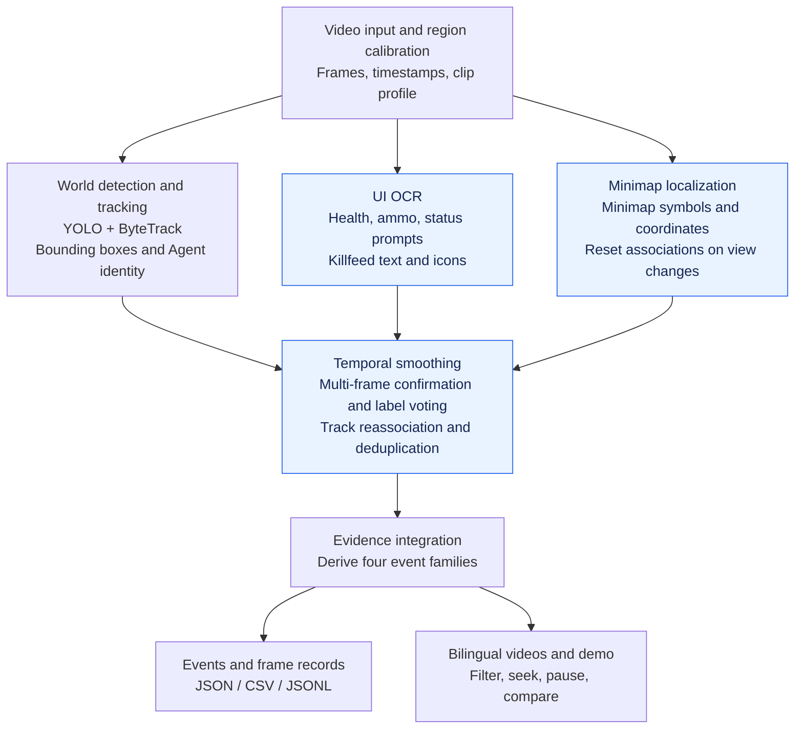
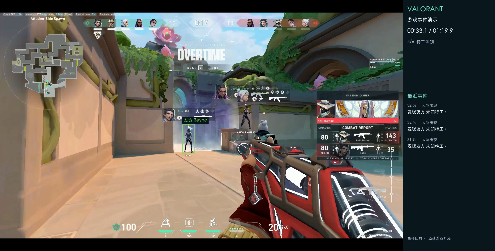
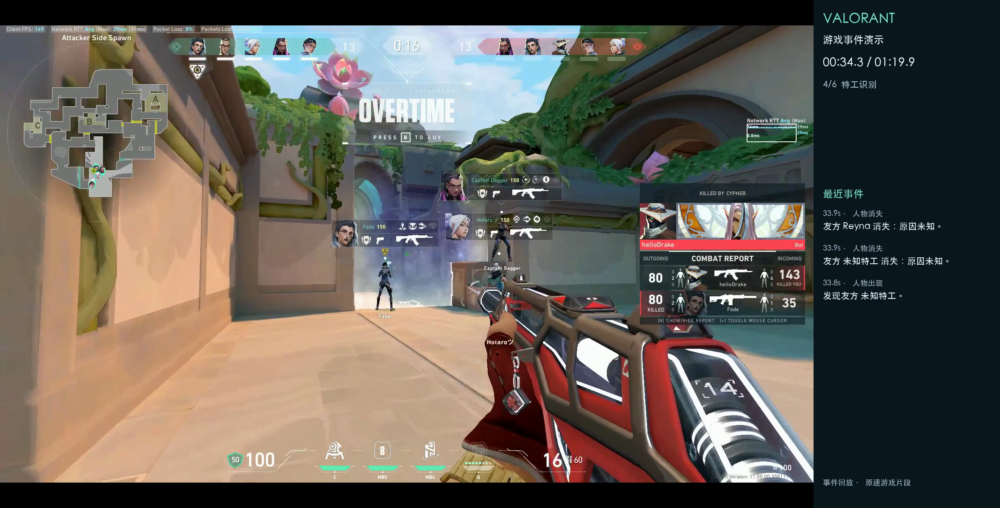
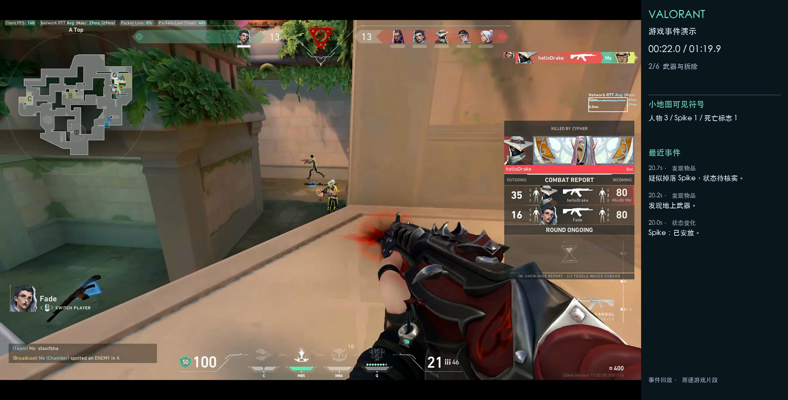

# Gameplay Event Detection from Video — VALORANT

**[English demo](https://xuyw041006-arch.github.io/valorant-detect/) · [中文在线演示](https://xuyw041006-arch.github.io/valorant-detect/DEMO.html) · [Video evaluation](https://xuyw041006-arch.github.io/valorant-detect/EVALUATION_en.html)**

[English](README_en.md) | [简体中文](README_zh.md)

This Python project converts visual information from gameplay recordings into object tracks and structured events. It detects enemy and teammate characters, dropped and planted Spike, and ground weapons, combining these detections with HUD, killfeed and selected ability observations. The system does not read game memory or use live match data APIs.

The submission includes [Python source](src/valorant_events/), this bilingual README, [sample JSON](events.json)/[CSV](events.csv), and annotated videos in [Chinese](docs/presentation/valorant_demo_zh.mp4) and [English](docs/presentation/valorant_demo_en.mp4). The [interactive demo](https://xuyw041006-arch.github.io/valorant-detect/) contains 128 reviewed events with four event families and 21 specific event filters. Open the hosted demo to filter events and jump to their video timestamps.

## Approach used

The system processes each frame through three observation paths: the world view, gameplay UI and minimap. Temporal rules stabilize observations, combine evidence and generate events. The diagram shows the overall workflow. Modules run according to each video's configuration and sampling intervals; not every model runs on every frame.



## Models and tools selected

| Model/tool | Purpose and reason for selection |
| --- | --- |
| Fine-tuned YOLO26 models | YOLO26 pretrained models are fine-tuned separately for characters and Spike, Agent identity, weapons, ability objects, smoke and minimap symbols. They reuse pretrained visual features without training models from scratch. |
| ByteTrack | Associate detections across frames and provide track IDs for event generation. |
| EasyOCR and offline icon templates | Read health, ammo and game prompts; use portraits and weapon icons to help interpret the killfeed. |
| OpenCV, Python and a local HTML/JavaScript viewer | Handle video processing, region cropping, temporal logic, structured export and interactive review. |

Fine-tuning used a Colab A100. This repository retains only the six checkpoints used by the final configurations, inference and presentation code, and necessary evaluation inputs. See the [model manifest](weights/manifest.json).

## Data sources

Model fine-tuning used public VALORANT images and annotations, primarily the Roboflow datasets for [characters and Spike](https://universe.roboflow.com/daniels-magonis-0pjzx/valorant-9ufcp/dataset/3), [Agent identity](https://universe.roboflow.com/valorant-object-detection/valorant-object-detection-r9qkl/dataset/21), [ability objects](https://universe.roboflow.com/valorantdetector-wvavl/valorant_detector/dataset/2), [smoke and effects](https://universe.roboflow.com/cso-esports/cso-vision-valorant/dataset/8), and [minimap symbols](https://universe.roboflow.com/valo-wix1q/valo-minimap/dataset/10). Gameplay recordings and some supplementary extracted frames came from [BEACON](https://huggingface.co/datasets/beacon-gui/BEACON-Dataset) and [D2E](https://huggingface.co/datasets/open-world-agents/D2E-Original).

The project selected samples, standardized labels, added some annotations and fine-tuned models using these public sources. Some supplementary annotations were generated with AI assistance, and the author reviewed a subset of samples. Reference annotations for video event evaluation were also generated by AI and initially checked by the author. Their accuracy limitations are described on the [video evaluation page](https://xuyw041006-arch.github.io/valorant-detect/EVALUATION_en.html).

Rights to public datasets and original media remain with their respective rights holders, and their original licenses govern use. This project is a noncommercial technical demonstration for a job application.

## How events are derived from detections

Multi-frame confirmation, label voting, short-gap track association and deduplication stabilize observations before events are emitted.

| Event | Derivation |
| --- | --- |
| `person_appeared` | Confirm a newly visible person track. Attach team and Agent identity when sufficient evidence supports them. |
| `person_disappeared` | A track remains absent for a configured interval, or a new killfeed record confirms a death. Death uses `details.reason = "death"`, with killer and weapon fields when supported. |
| `object_detected` | Observe a weapon, Spike or ability object supported by evidence. An object's disappearance alone does not establish that it was picked up. |
| `state_changed` | Confirm a HUD value change, or use Spike/status/effect evidence to identify a new state. Numeric changes retain `field`, `from` and `to`. |

Death is a subtype of person disappearance. Enemy disappearances without a confirmed death share the viewer label “Non-death disappearance”; this does not confirm survival. Uncertain identities use `null` or `unknown`. Track IDs are not permanent player identities across clips.

Events include the required `timestamp`, `event` and `confidence` fields, use `subject` to identify the event's subject (a character or object), and provide `details` as needed. Timestamps are seconds on the merged demo video's timeline. The following record from [events.json](events.json) represents a character being killed, including the victim's team and Agent identity, the killer and the weapon:

```json
{
  "timestamp": 1.4,
  "event": "person_disappeared",
  "confidence": 0.992,
  "subject": {
    "team": "teammate",
    "agent": "sage"
  },
  "details": {
    "reason": "death",
    "killer": "waylay",
    "weapon": "Ghost"
  }
}
```

See [events.csv](events.csv) for tabular output and [event_schema.json](event_schema.json) for the complete schema.

## Limitations and concrete failure cases

1. **The same character may be recorded more than once.** For example, an enemy briefly obscured by a corner or smoke, or seen again after a rapid camera turn, may receive a new track ID and be recorded as disappearing and reappearing. Low resolution, outlines visible through walls and bodies can also interfere with detection. Short-gap reassociation reduces this problem but does not eliminate it.

2. **UI changes can cause missed readings or interrupted associations.** A recording from a different player may use a different HUD scale or position. Previously calibrated regions may crop out part of the ammo counter, causing missed or incorrect ammo-change events. Minimap rotation, zoom or switching to a full-map view can reset symbol associations and interrupt continuous tracking. New layouts therefore require recalibration.

3. **Small objects or appearances not covered by the data may be missed or misclassified.** A distant dropped weapon may occupy only a few pixels, or an ability object may be obscured by effects. Annotation coverage for ground weapons and some abilities remains limited. Data from different game versions may omit new Agents or appearances, causing unknown or incorrect identities. Small weapons and Agent identities can be confused; killfeed recognition depends on clear portraits, icons and text, with uncertain fields left unknown.

These failures are related to dataset size, scene coverage and differences between game versions. The models may still fail to recognize some characters and weapons from newer versions.

Minimap positions describe relative locations in the image, not world coordinates or hidden enemy positions. The minimap ability-type classifier is disabled because its rotation tests were unstable. Some abilities are demonstrated only through selected still frames, which do not establish reliable recognition of all abilities or smoke types. The system processes video offline and does not guarantee real-time speed.

The three examples below retain the original detection boxes, text and gameplay images. All timestamps refer to the merged demo video.

### 1. Incorrect Agent identity or association (33.10 seconds)

The game's portrait and name for the character on the left show **Fade**, but the detection box is labeled “Teammate Reyna” in Chinese. Detecting a character does not guarantee that the Agent identity or its association with the bounding box is correct.



### 2. A disappearance event while the character is still visible (34.30 seconds)

Reyna remains visible on the box, but the event panel has already recorded “Teammate Reyna disappeared: reason unknown” at 33.9 seconds. When detection or track association breaks, a brief missed detection can be interpreted as a disappearance.



### 3. Missed visible enemies (22.00 seconds)

Two enemies with yellow outlines are visible in the central passage, but neither has a detection box. The frame record also contains no person tracks at this timestamp. Small targets or unusual outline appearances can still be missed.



## Running locally

Run all commands below from the repository root.

### 1. Install inference dependencies

Use a Python 3.10–3.12 virtual environment; Python 3.12 has been verified. On Windows, replace the activation command with `.venv\Scripts\activate`.

```bash
python -m venv .venv
source .venv/bin/activate
python -m pip install -r requirements.txt
python -m pip install -e . --no-deps
python scripts/prepare_ocr.py
```

`prepare_ocr.py` downloads the standard English OCR inference weights on first use. In Colab, retain the existing compatible PyTorch/CUDA versions. Inference requires no account or API key.

### 2. Run video inference

Use the video, weights and matching configuration included in the repository:

```bash
python -m valorant_events.pipeline \
  --video media/v3/P006_S001_tactical_test_600_620.mp4 \
  --weights weights/best.pt \
  --config configs/integrated_p006.json \
  --device cpu --output runs/p006
```

Use `--device 0` for a compatible CUDA GPU or `--device mps` for an Apple GPU; OCR still runs on the CPU. Choose a new output directory for each run. When using a different video, adjust the configuration and [recalibrate the HUD and minimap](https://xuyw041006-arch.github.io/valorant-detect/hud_calibration.html?lang=en).

To run inference on all six original clips with their respective configurations:

```bash
python scripts/run_demo_inference.py --device cpu --output runs/all_clips
```

### 3. Inspect inference outputs

Results for a single video are saved in the directory specified by `--output`. The main files are:

- `annotated.mp4`: inference video with detection boxes and event messages.
- `compact/events.json` and `compact/events.csv`: structured results using the four event families.
- `tracks.jsonl`: per-frame bounding boxes, tracks and related observations.
- `run_summary.json`: run status, processed frame count and statistics.

Event timestamps follow the input video's timeline. Batch inference saves each clip's results separately.

## Repository layout

| Path | Contents |
| --- | --- |
| `src/valorant_events/` | Final inference, tracking, HUD and event logic |
| `configs/`, `weights/`, `assets/`, `effects/` | Six video configurations, final checkpoints and reference assets |
| `docs/` | Bilingual static demos, videos, ability screenshots and evaluation pages |
| `media/`, `examples/render_inputs/`, `presentation/` | Original clips, render records and timeline information |
| `evaluation/` | AI reference annotations, all predictions and matching results |
| `scripts/` | Final inference, rendering, page generation and local serving commands |
