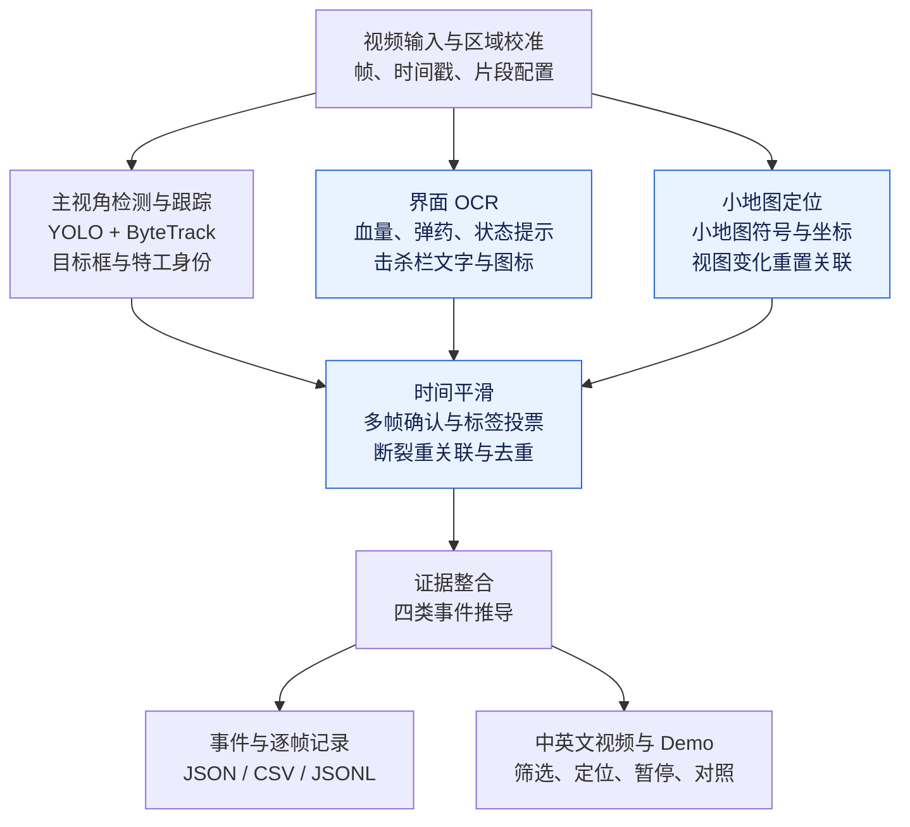

# 游戏视频事件检测 — VALORANT

**[中文在线演示](https://xuyw041006-arch.github.io/valorant-detect/DEMO.html) · [English demo](https://xuyw041006-arch.github.io/valorant-detect/) · [视频评估](https://xuyw041006-arch.github.io/valorant-detect/EVALUATION.html)**

[English](README_en.md) | [简体中文](README_zh.md)

本项目使用 Python，将游戏录像中的视觉信息转换为目标轨迹和结构化事件。系统检测敌方/友方人物、掉落/已安放的 Spike、地面武器，并结合 HUD、击杀栏和部分技能观察。系统不读取游戏内存，也不使用实时对局数据接口。

提交材料包括 [Python 源码](src/valorant_events/)、本中英文 README、[样例 JSON](events.json)/[CSV](events.csv)，以及[中文](docs/presentation/valorant_demo_zh.mp4)/[英文](docs/presentation/valorant_demo_en.mp4)标注视频。[交互 Demo](https://xuyw041006-arch.github.io/valorant-detect/DEMO.html)包含 128 条复核后的展示事件，提供四个大类、21 个具体事件筛选项。可直接打开在线 Demo，筛选事件并跳转到对应的视频时间。

## 采用的方法

系统把同一帧拆成主视角、游戏界面和小地图三条观察路径，再用时间规则稳定观察、整合证据并生成事件。下图展示整体处理流程，各模块按对应视频配置和采样频率启用，并非每一帧都执行全部模型。



## 选择的模型与工具

| 模型/工具 | 用途与选择原因 |
| --- | --- |
| 微调后的 YOLO26 系列模型 | 基于 YOLO26 系列预训练模型，针对人物与 Spike、特工身份、武器、技能道具、烟雾及小地图符号分别进行微调，复用预训练视觉特征，无需从零训练模型。 |
| ByteTrack | 关联跨帧检测结果，提供用于事件推导的轨迹编号。 |
| EasyOCR 与离线图标模板 | 读取血量、弹药及游戏提示，利用头像和枪械图标辅助解释击杀栏。 |
| OpenCV、Python、HTML/JavaScript 本地演示 | 完成视频处理、区域裁剪、时间逻辑、结构化导出和交互复核。 |

微调使用 Colab A100。本仓库只保留最终配置使用的 6 个权重、推理与演示代码、必要评估输入。模型列表见[权重清单](weights/manifest.json)。

## 数据来源声明

本项目的模型微调使用了公开的 VALORANT 图像及标注数据，主要包括 Roboflow 上的[人物与 Spike 数据集](https://universe.roboflow.com/daniels-magonis-0pjzx/valorant-9ufcp/dataset/3)、[特工身份数据集](https://universe.roboflow.com/valorant-object-detection/valorant-object-detection-r9qkl/dataset/21)、[技能道具数据集](https://universe.roboflow.com/valorantdetector-wvavl/valorant_detector/dataset/2)、[烟雾与效果数据集](https://universe.roboflow.com/cso-esports/cso-vision-valorant/dataset/8)和[小地图符号数据集](https://universe.roboflow.com/valo-wix1q/valo-minimap/dataset/10)。游戏实录与部分补充抽帧素材来自 [BEACON](https://huggingface.co/datasets/beacon-gui/BEACON-Dataset) 和 [D2E](https://huggingface.co/datasets/open-world-agents/D2E-Original)。

在公开数据基础上，本项目进行了样本筛选、标签统一、部分补充标注和模型微调。部分补充标注使用 AI 辅助生成，作者对部分样本进行了复核。视频事件评估的参考标注同样由 AI 生成并经作者初步核对，其准确性限制见[视频评估页面](https://xuyw041006-arch.github.io/valorant-detect/EVALUATION.html)。

公开数据与原始素材的权利归各自权利人，使用范围遵循原始许可。本项目用于非商业的求职技术演示。

## 如何从检测结果推导事件

系统先通过多帧确认、标签投票、短间隔轨迹关联和去重稳定观察，再输出事件。

| 事件 | 推导逻辑 |
| --- | --- |
| `person_appeared` | 确认新出现的可见人物轨迹；有足够证据支持时附加阵营与特工身份。 |
| `person_disappeared` | 追踪轨迹持续缺失一定时间，或新的击杀栏记录确认死亡。死亡使用 `details.reason = "death"`，证据支持时补充击杀者和枪械。 |
| `object_detected` | 观察到有证据支持的武器、Spike 或技能物体。物体消失不能直接推断为物体被拾取走。 |
| `state_changed` | 确认 HUD 数值变化，或 Spike/状态/效果证据表明进入新状态。数值变化保存 `field`、`from`、`to`。 |

死亡归入人物消失。敌方没有确认死亡的消失在界面统一显示为“非死亡消失”，但这不代表确认其存活。不确定身份使用 `null` 或 `unknown`；轨迹编号不是跨片段永久有效的玩家身份。

事件包含题目要求的 `timestamp`、`event`、`confidence`，使用 `subject` 表示事件主体（角色或物品），并按需提供 `details`。时间戳为合并演示视频中的秒数。以下为 [events.json](events.json) 中的真实记录，表示一名角色被击杀，包含被击杀者阵营、特工身份、击杀者和枪械信息：

```json
{
  "timestamp": 1.4,
  "event": "person_disappeared",
  "confidence": 0.992,
  "subject": {
    "team": "teammate",
    "agent": "sage"
  },
  "details": {
    "reason": "death",
    "killer": "waylay",
    "weapon": "Ghost"
  }
}
```

表格输出和完整格式约束分别见 [events.csv](events.csv)、[event_schema.json](event_schema.json)。

## 限制与具体失败情况

1. **同一人物被重复记录。** 例如敌人短暂被墙角或烟雾遮挡，或者镜头快速转动后再次看到该敌人，跟踪器可能分配新的 ID，导致同一人物被记录为“消失后重新出现”。低分辨率、穿墙轮廓和尸体也可能干扰检测；短间隔重关联可以缓解这类问题，但不能完全消除。

2. **界面变化导致漏读或关联中断。** 例如换用另一位玩家的录像后，HUD 缩放或位置发生变化，原先校准的区域可能裁不全弹药数字，造成弹药变化漏报或误报。小地图旋转、缩放或切换全图时，系统可能重置符号关联，无法保持连续轨迹，因此新布局需要重新校准。

3. **小物体或未覆盖的外观被漏检、错分。** 例如远处掉落的枪械只占少量像素，或技能道具被特效遮挡，模型可能无法识别。地面武器和部分技能的标注样本覆盖仍有限；来自不同游戏版本的数据也可能缺少新特工或新外观，导致身份未知或分类错误。小型武器与特工身份可能混淆；击杀栏识别依赖清晰的头像、图标和文字，不确定字段保持未知。

此外，这些失败情况与数据规模、场景覆盖和游戏版本差异有关，模型仍可能无法识别部分新版本角色和枪械。

小地图定位仅表示图像中的相对位置，不代表世界坐标或隐藏敌人的位置；小地图技能类型分类器因旋转测试不稳定而关闭。部分技能仅有选取的单帧展示，尚不能证明所有技能或烟雾类型均可可靠识别。当前系统为离线处理，不保证实时速度。

以下为三个例子，未改动截图中的检测框、文字或游戏画面。时间均为合并后演示视频的时间。

### 1. 特工身份识别或关联错误（33.10 秒）

左侧人物的游戏原生头像和名称显示为 **Fade（黑梦）**，但检测框标签却是“友方 Reyna”。这说明检测到人物后，特工身份识别及其与目标框的关联仍可能出错。


### 2. 人物仍然可见，却产生消失事件（34.30 秒）

箱子上的 Reyna 仍然可见，但右侧已经记录了 33.9 秒的“友方 Reyna 消失：原因未知”。检测或跟踪关联中断时，系统可能把短暂漏检当作人物消失。


### 3. 可见敌人漏检（22.00 秒）

画面中央通道内有两名带黄色轮廓的敌人，但均没有检测框；该时刻的逐帧记录也没有人物轨迹。这表明对较小目标或特殊轮廓外观的检测仍可能出现漏检。


## 本地运行

以下命令均在仓库根目录执行。

### 1. 安装推理依赖

推荐 Python 3.10–3.12 虚拟环境，已验证 3.12。Windows 将激活命令替换为 `.venv\Scripts\activate`。

```bash
python -m venv .venv
source .venv/bin/activate
python -m pip install -r requirements.txt
python -m pip install -e . --no-deps
python scripts/prepare_ocr.py
```

`prepare_ocr.py` 首次下载标准英文 OCR 推理权重。Colab 中保留原有兼容的 PyTorch/CUDA 版本。推理无需账号或 API Key。

### 2. 运行视频推理

使用仓库提供的视频、权重及对应配置：

```bash
python -m valorant_events.pipeline \
  --video media/v3/P006_S001_tactical_test_600_620.mp4 \
  --weights weights/best.pt \
  --config configs/integrated_p006.json \
  --device cpu --output runs/p006
```

兼容 CUDA 显卡使用 `--device 0`；Apple GPU 可使用 `--device mps`，OCR 仍在 CPU 上运行。每次选择新的输出目录。更换视频时，需要调整配置并重新[校准 HUD 与小地图](https://xuyw041006-arch.github.io/valorant-detect/hud_calibration.html?lang=zh)。

如需按各自配置推理全部六个原始切片：

```bash
python scripts/run_demo_inference.py --device cpu --output runs/all_clips
```

### 3. 查看推理输出

单个视频的结果保存在 `--output` 指定的目录中，主要包括：

- `annotated.mp4`：带检测框和事件提示的推理视频。
- `compact/events.json`、`compact/events.csv`：采用四类事件格式的结构化结果。
- `tracks.jsonl`：逐帧目标框、轨迹及相关观察记录。
- `run_summary.json`：运行状态、处理帧数和统计信息。

事件时间戳对应输入视频的时间轴；批量推理时，每个切片的结果分别保存。

## 仓库结构

| 路径 | 内容 |
| --- | --- |
| `src/valorant_events/` | 最终推理、跟踪、HUD 和事件逻辑 |
| `configs/`、`weights/`、`assets/`、`effects/` | 六套视频配置、最终权重及参考素材 |
| `docs/` | 双语静态 Demo、视频、技能截图及评估页面 |
| `media/`、`examples/render_inputs/`、`presentation/` | 原始切片、绘制记录及时间轴信息 |
| `evaluation/` | AI 参考标注、全部预测、匹配结果 |
| `scripts/` | 最终推理、渲染、网页生成及本地服务命令 |
